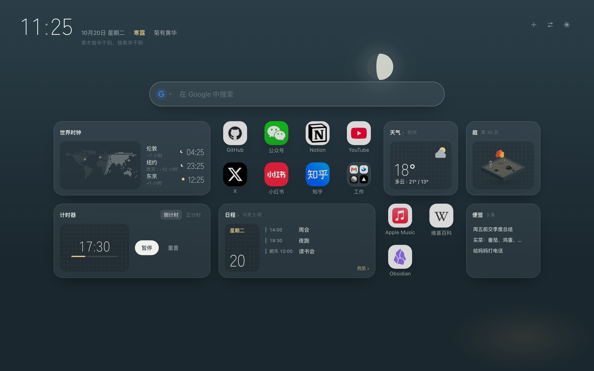

<p align="center">
  
</p>

<h1 align="center">Niwa · 庭</h1>

<p align="center">一方安静的新标签页：节气与山水，快捷方式和小组件自由摆放。<br>适用于 Edge / Chrome，数据都留在你自己的浏览器里。</p>

<p align="center"><a href="https://microsoftedge.microsoft.com/addons/detail/niwa/aonnmkpdcdkcfhcionbpmigmfbjcmnec">Edge 扩展商店</a> · <a href="../../releases">下载 zip</a></p>




## 特点

- **随时节变化的景**：背景的山水跟着季节、时辰变化；深色是「夜庭」，月亮按当天真实的月相画。可以让背景跟随天气，阴天、下雨、下雪时一起变。
- **二十四节气、七十二候**：时间旁边写着今天的节气和候，下面一行是这一候在元代吴澄《月令七十二候集解》里的解释。
- **自由摆放的网格**：快捷方式和小组件放在同一张网格里，可以拖到任意位置、留空、叠放。拖动参照手机桌面，停稳了才让位。快捷方式也能收进文件夹。
- **10 种小组件**（右上角「添加」里先预览再添加），同一种可以放好几个，各管各的：
  - 便签：回车保存，点一下复制；在页面任意处粘贴，直接存成一条
  - 日程：订阅 Google 日历或任意 iCal 地址，也能直接导入 .ics 文件，有月历
  - 庭：一方小小的箱庭，你打开的天数越多，长出的东西越多
  - 天气：和风天气的实况、24 小时和 7 天预报
  - 世界时钟：几个城市的时间，配一张昼夜分明的点阵地图
  - 计时器：倒计时和正计时，到点在正在看的网页里弹通知
  - 热榜：知乎、微博、B 站、百度、头条、掘金的热门
  - 订阅：RSS / Atom
  - 收藏夹、历史：在新标签页里翻浏览器的收藏和浏览记录
- **搜索**：按 `/` 聚焦，输入时从你的收藏和浏览记录里联想（只读本地数据，不联网）。搜索引擎可以自己加：常用的（Yandex、搜狗、Perplexity、ChatGPT、Claude、GitHub、知乎、B 站等）点一下就有，其他的填网站地址自动识别。
- **备份与恢复**：全部布局和设置导出成一个文件，在另一个浏览器里导入。

## 安装

**Edge**：在 [Edge 扩展商店](https://microsoftedge.microsoft.com/addons/detail/niwa/aonnmkpdcdkcfhcionbpmigmfbjcmnec) 点「获取」，以后会自动更新。

**Chrome，或者想先用上最新版**：商店的新版本要等审核，可能比 GitHub 晚几天。也可以手动安装（不会自动更新，有新版本时重新下载、覆盖原来的文件夹，再到扩展页点「重新加载」）：

1. 在 [Releases](../../releases) 下载最新的 `niwa-<版本>.zip`，解压到一个不会删掉的文件夹。
2. 打开 `edge://extensions`（Chrome 是 `chrome://extensions`），打开「开发人员模式」。
3. 点「加载解压缩的扩展」，选择刚才解压出来的文件夹。
4. 打开一个新标签页；浏览器问要不要保留更改时，选择保留。

商店版和手动安装的是两个不同的扩展，数据不互通。从手动安装换到商店版：先在原来的 Niwa 里「设置 › 备份与恢复」导出，装好商店版后再导入，然后移除原来那个。

想自己构建：

```sh
pnpm install
pnpm exec wxt build -b edge   # 输出在 .output/edge-mv3/
```

只支持 Chromium 内核的浏览器（Edge、Chrome 等），不支持 Firefox。

## 隐私

Niwa 没有服务器，不收集、不上传任何数据，也没有统计。你的布局、便签和设置都只存在这个浏览器里。

打开新标签页本身不联网。只有在你主动用了某个功能时，才会直接请求对应的网站，比如你订阅的日历、你填了 KEY 的和风天气、你添加的热榜和订阅、你要识别的搜索引擎。安装时不申请任何敏感权限，用到时再问，详见 [隐私说明](PRIVACY.md)（[English](PRIVACY.en.md)）。

## 常见问题

**天气怎么用？**
天气来自[和风天气](https://dev.qweather.com/)，需要你自己的免费 KEY：注册和风天气的开发者账号，创建一个项目，拿到 API KEY，再在控制台的「设置」里找到你账号专属的 API Host。把这两个填进天气小组件的「天气设置」，然后搜索城市即可。

**热榜突然用不了了？**
热榜用的是各网站自己网页上的接口，不是公开 API，网站一改就可能失效，失效时会显示「数据格式变了」。欢迎提 [issue](../../issues)。微博的热榜要先在这个浏览器里登录微博。

**换电脑了怎么办？**
在设置面板的「备份与恢复」里导出，到新电脑上导入。日历订阅地址、天气 KEY 这些私密信息默认不导出，要导出得手动勾选。

## 参与开发

用 [WXT](https://wxt.dev/) + React + TypeScript 开发。目录结构、各功能的实现、代码约定、测试见 [开发说明](docs/DEVELOPMENT.md)。欢迎提 issue 和 PR。

## 致谢

- 时钟字体：[Zen Kaku Gothic New](https://github.com/googlefonts/zen-kakugothic)（SIL Open Font License 1.1，见 `public/fonts/OFL.txt`）
- 世界地图：[Natural Earth](https://www.naturalearthdata.com/) 陆地数据（公有领域）
- 七十二候的解释：元代吴澄《月令七十二候集解》，据[维基文库](https://zh.wikisource.org/)本整理
- 搜索引擎图标：[Simple Icons](https://simpleicons.org/)（CC0），商标归各自所有
- 读取日历：[ical.js](https://github.com/kewisch/ical.js)（MPL-2.0）
- 默认快捷方式的网站图标取自各网站（经 [icon.horse](https://icon.horse/)），商标归各自所有，只用来显示快捷方式

## 许可证

[MIT](LICENSE)
